<div align="center">

<a href="https://beacon-oop.vercel.app"></a>

<br>


<br><br>

<a href="https://beacon-oop.vercel.app"></a>
<a href="https://oops-cp-backend-production.up.railway.app/api/health"></a>

<a href="https://github.com/sameera-7-hash/OOPs-CP-frontend"></a>
<a href="https://github.com/sameera-7-hash/OOPs-CP-backend"></a>


<br><br>

<a href="#-tour-the-live-app"></a>

<br><br>

<b><a href="#-why-beacon">Why Beacon</a> · <a href="#-tour-the-live-app">Live tour</a> · <a href="#-features">Features</a> · <a href="#-try-it-in-60-seconds">Try it</a> · <a href="#-under-the-hood">Under the hood</a> · <a href="#-run-it-yourself">Run it</a></b>

</div>


## 🔦 Why Beacon

> **When people feel unwell, the hard part isn't booking. It's knowing what to do.**
> Rest at home? See a doctor this week? Call an ambulance *now*? And which doctor?

**Beacon is the light that answers that.** A patient picks what they're dealing with
and gets clear self‑care steps, what to ask a doctor, and a red **emergency screen with
tap‑to‑call numbers** when it's serious. One tap later they're looking at the right
specialists with **only the time slots that are really open**. Doctors and nurses work
from the same system, and every medical record is **encrypted and tamper‑evident**.

It's not a mockup. It's **deployed, working and open to try right now**:
the React app runs on Vercel, and the C++17 API runs on Railway from this repo's `Dockerfile`.

<div align="center">
</div>


## 🎬 Tour the live app

<div align="center">

<a href="https://beacon-oop.vercel.app"></a>

<sub><b>The front door.</b> A calm, painted landing page. Click it to open the real thing.</sub>

</div>

<br>

<table>
  <tr>
    <td width="50%" valign="top">
      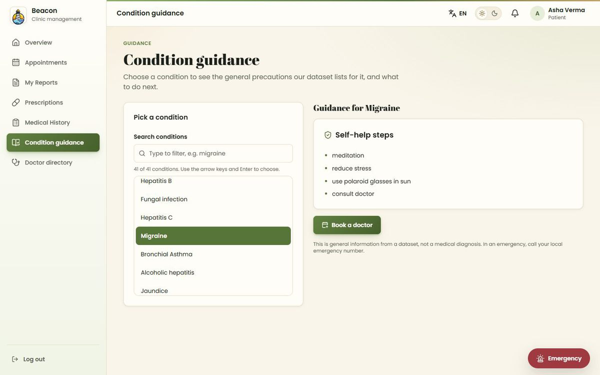
      <p><b>🧭 Condition guidance.</b> Search 41 conditions and get self‑help steps, then <i>Book a doctor</i> goes straight to the right specialists.</p>
    </td>
    <td width="50%" valign="top">
      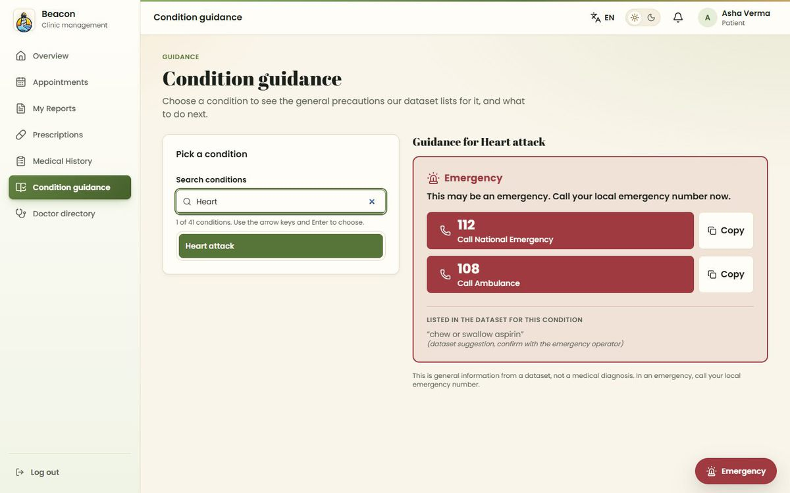
      <p><b>🚨 Emergency mode.</b> Serious conditions switch to a red screen with one‑tap <b>112</b> and <b>108</b> buttons. No digging around.</p>
    </td>
  </tr>
  <tr>
    <td width="50%" valign="top">
      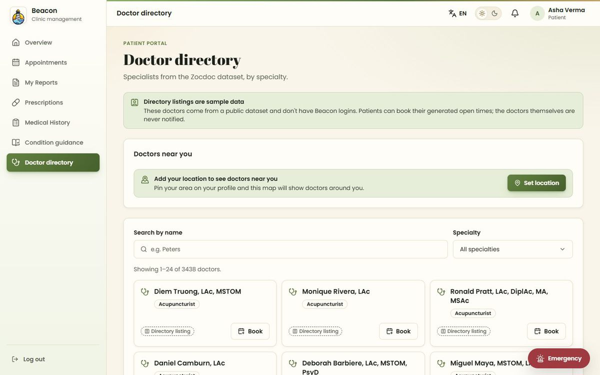
      <p><b>🩺 Doctor directory.</b> 3,438 specialists across 102 specialties, with search, filters, a map of doctors near you and booking from every card.</p>
    </td>
    <td width="50%" valign="top">
      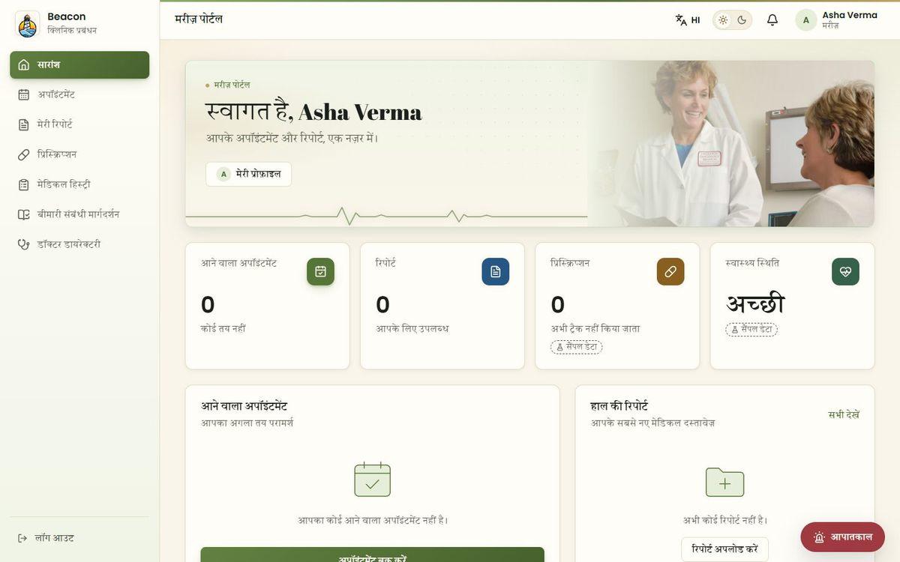
      <p><b>🌐 पूरी तरह हिन्दी में.</b> One click on <b>EN</b> switches the whole interface to Hindi, with a proper Devanagari font.</p>
    </td>
  </tr>
  <tr>
    <td width="50%" valign="top">
      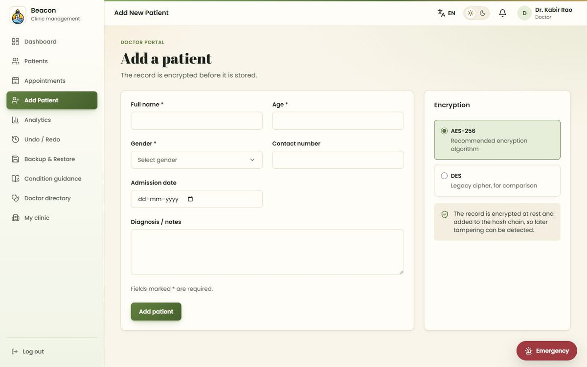
      <p><b>🔐 Encrypted records.</b> Doctors choose AES‑256 (or DES, for comparison). The record is encrypted and chained before it touches the disk.</p>
    </td>
    <td width="50%" valign="top">
      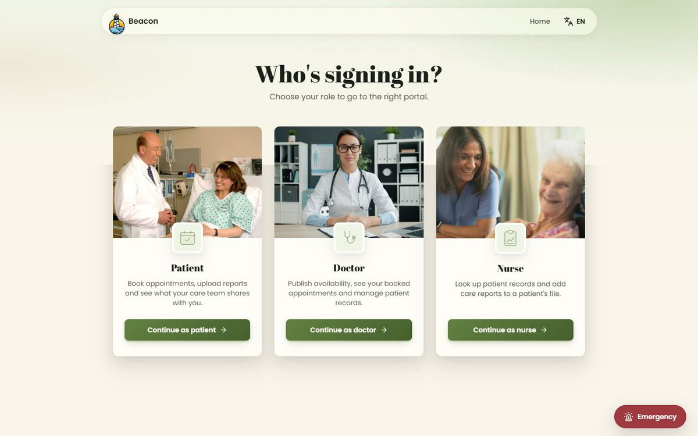
      <p><b>👥 Three portals, one system.</b> Patients, doctors and nurses each get their own workspace, all backed by the same API.</p>
    </td>
  </tr>
</table>


## ⚡ Features

<table>
  <tr>
    <td width="33%" valign="top">
      <h3>🧭 Guidance first</h3>
      Self‑care steps, questions for the doctor and a clear next action for 41 conditions. The urgency level never comes out lower than a reviewed safety floor.
    </td>
    <td width="33%" valign="top">
      <h3>📅 Real slots only</h3>
      Doctors publish their hours; patients see only open times. The server re‑checks every booking, so two people can never take the same slot.
    </td>
    <td width="33%" valign="top">
      <h3>🗺️ Maps & clinics</h3>
      Patients pin their area and see doctors nearby; doctors pin their clinic so patients know where to go.
    </td>
  </tr>
  <tr>
    <td valign="top">
      <h3>🔐 Encrypted at rest</h3>
      Every patient record is encrypted with OpenSSL (AES‑256‑CBC, fresh IV each time) before it is written.
    </td>
    <td valign="top">
      <h3>⛓️ Tamper‑evident</h3>
      Records sit on a SHA‑256 hash chain. Edit, delete or reorder anything in the past and every later link shows it.
    </td>
    <td valign="top">
      <h3>♻️ Self‑healing storage</h3>
      Each write is mirrored to a backup; if the main file is damaged, Beacon loads the backup on its own.
    </td>
  </tr>
  <tr>
    <td valign="top">
      <h3>🔑 Serious sign‑in</h3>
      PBKDF2 password hashing (100,000 rounds), lockout after 5 wrong tries, 4‑hour sessions and a forgot‑password code by email.
    </td>
    <td valign="top">
      <h3>📄 Reports & reminders</h3>
      Patients upload PDF or text reports; nurses add care reports; everyone gets a reminder when a visit is booked.
    </td>
    <td valign="top">
      <h3>🌗 For everyone</h3>
      English and हिन्दी, light and dark themes, keyboard navigation and screen‑reader labels throughout.
    </td>
  </tr>
</table>


## 🧪 Try it in 60 seconds

1. Open **[beacon-oop.vercel.app](https://beacon-oop.vercel.app)** and click **Enter Beacon → Log in → Continue as patient**, then create an account with any email. *(The API can take a few seconds to wake up on the first visit.)*
2. Go to **Condition guidance**, pick **Migraine**, then press **Book a doctor**. Choose a date and an open time.
3. Now type **Heart attack** to see the emergency screen.
4. Press **EN** in the top bar to switch to **हिन्दी**, and use the toggle next to it for dark mode.
5. Sign up again as a **Doctor** to publish time slots and add an encrypted patient record, or as a **Nurse** to write a care report.

> [!NOTE]
> Screens marked **Sample data** (analytics, prescriptions, medical history, the nurse queues, vitals and tasks) are design previews with placeholder content. Everything else runs against the live API.


## 🧠 Under the hood

Beacon was built for an **Object‑Oriented Programming** course, so the backend is a
showcase of OOP in modern C++17. Every row below points at real code.

| OOP concept | Where it lives |
|---|---|
| **Abstraction** | `CipherStrategy` and `Mailer` are interfaces: callers say "encrypt this" or "send this email" without knowing how. |
| **Encapsulation** | `UserStore`, `SessionManager` and `PasswordResetService` keep their maps, locks and secrets private behind methods like `login()`. |
| **Inheritance** | `AesCipher` / `DesCipher` derive from `CipherStrategy`; five exception types derive from `AppException`. |
| **Polymorphism** | The ledger encrypts through a `CipherStrategy&`, whatever the algorithm; each exception reports its own `httpStatus()` (400, 401 …) through one handler. |
| **Composition** | `PatientStorage` *has a* `HashChainedLedger<Patient>`; the server is assembled from independent services. |
| **Generics** | `HashChainedLedger<T>` holds the append, verify and recover logic once, for any record type. |

| Design pattern | Class | Why it's there |
|---|---|---|
| **Strategy** | `CipherStrategy` → `AesCipher`, `DesCipher` | Pick the algorithm per record, at runtime. |
| **Factory** | `CipherFactory` | Turns `"AES"` / `"DES"` from a request into the right object, in one place. |
| **Decorator** | `LoggingCipher` | Adds logging to any cipher without touching its code. |
| **Singleton** | `Logger::instance()` | One shared, thread‑safe activity log. |
| **Dependency inversion** | `Mailer` → `BrevoMailer`, `ResendMailer`, `ConsoleMailer` | Reset emails go through a real provider in production and to the console in development, with no change to the reset logic. |

**How guidance decides urgency.** `PrecautionCleaner` tidies the raw precautions dataset at
startup (typos, stray spaces, empty cells) and logs every fix. `ActionClassifier` then
reads two signals, what the precaution text implies ("call ambulance" means emergency)
and a reviewed per‑condition severity floor, and always keeps the **more severe** one,
so nothing is under‑triaged. `DoctorDirectory` maps the condition to specialties and
finds doctors with open slots.

<details>
<summary><b>📐 Diagrams:</b> architecture, the patient journey, the record chain and the class model</summary>

<br>

**The system at a glance**

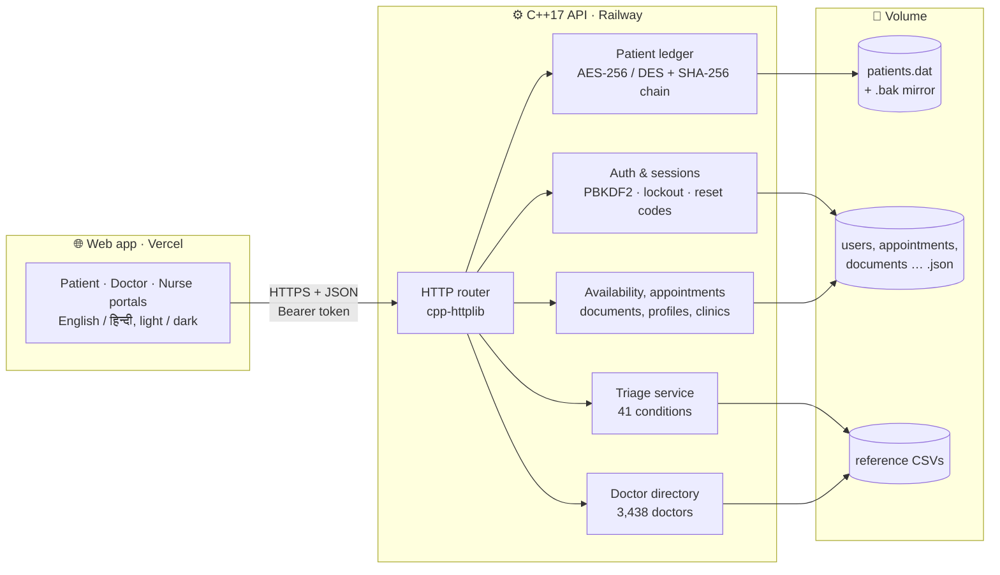

**A patient's journey**

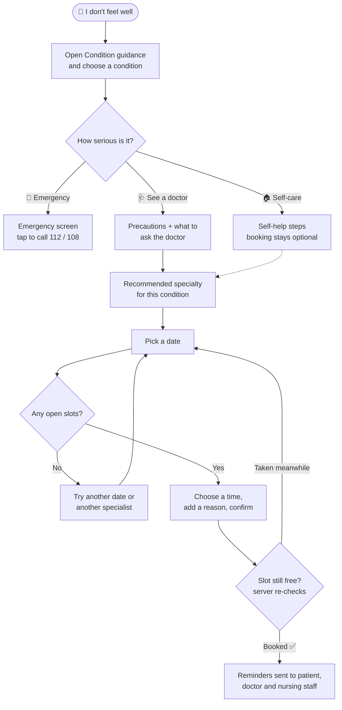

**What happens to a patient record**

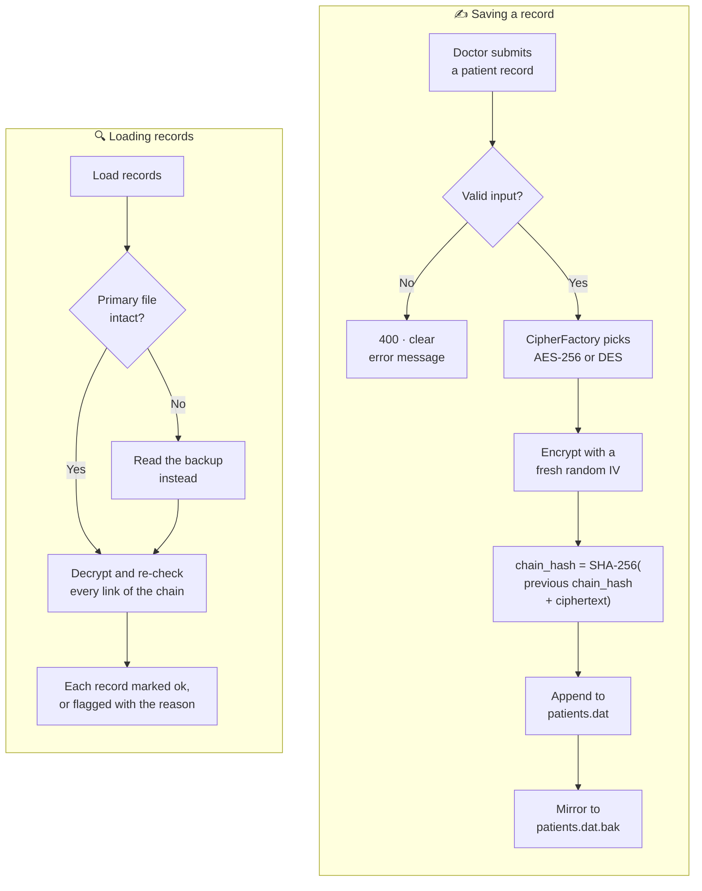

**The class model**

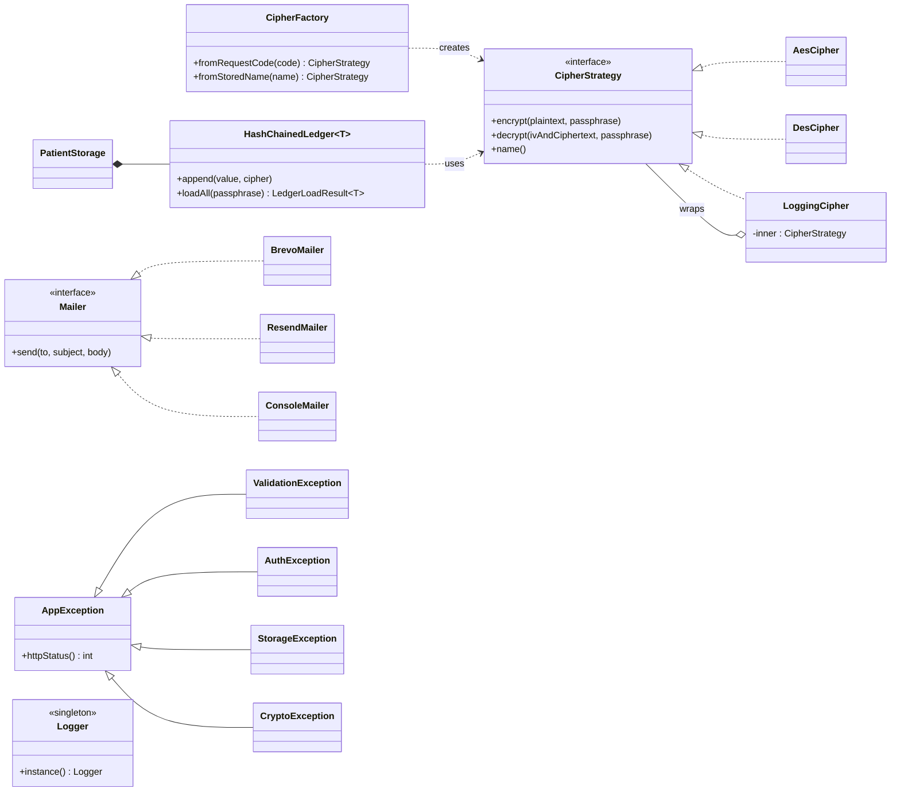

</details>

<details>
<summary><b>🧮 Data structures</b> you can see in the app</summary>

<br>

| Structure | Screen | Idea |
|---|---|---|
| **Queue (FIFO)** | Nurse → Patient queue | Patients are seen in arrival order. |
| **Priority queue (heap)** | Nurse → Priority queue | The most critical patient is always served first. |
| **Stack (LIFO)** | Doctor → Undo / Redo | The most recent action is undone first. |
| **Hash map** | Patient search, sessions, lockouts | Constant‑time lookup by ID, token or email. |
| **Append‑only hash chain** | Patient record storage | History that can only grow and can't be silently rewritten. |

</details>


## 🧩 Tech stack

| Layer | Technology |
|---|---|
| **Backend** | C++17, [cpp-httplib](https://github.com/yhirose/cpp-httplib), [nlohmann/json](https://github.com/nlohmann/json), OpenSSL 3, CMake + Ninja |
| **Frontend** | React 19, Vite 8, Tailwind CSS 4, Radix UI, Leaflet maps, i18next (English / Hindi), lucide icons |
| **Deployment** | Docker (two‑stage, non‑root), Railway (API), Vercel (web app) |
| **Data** | Encrypted append‑only ledger + JSON stores on a persistent volume |

| Repository | What's in it |
|---|---|
| [**OOPs-CP-backend**](https://github.com/sameera-7-hash/OOPs-CP-backend) | The C++17 API (`patient_dashboard/backend`), datasets, `Dockerfile`, and the original console app |
| [**OOPs-CP-frontend**](https://github.com/sameera-7-hash/OOPs-CP-frontend) | The React web app deployed to Vercel |


## 🚀 Run it yourself

**The API, with Docker** (from a clone of [OOPs-CP-backend](https://github.com/sameera-7-hash/OOPs-CP-backend)):

```bash
PATIENT_DB_KEY="choose-a-long-passphrase" docker compose up --build
# PowerShell:  $env:PATIENT_DB_KEY="choose-a-long-passphrase"; docker compose up --build
```

Then open **http://localhost:8080/api/health**, which should return `{"status":"ok"}`.

**The API, with CMake** (Linux: `build-essential cmake ninja-build libssl-dev`):

```bash
cd patient_dashboard/backend
cmake --preset linux-release && cmake --build --preset linux-release
PATIENT_DB_KEY="choose-a-long-passphrase" ./build/linux-release/patient_server
```

On Windows, open `patient_dashboard/backend` in Visual Studio and pick the **Windows x64 (vcpkg)** preset.

**The web app** (from a clone of [OOPs-CP-frontend](https://github.com/sameera-7-hash/OOPs-CP-frontend)): `npm install` then `npm run dev`. It proxies `/api` to `localhost:8080`.

<details>
<summary><b>Environment variables and deployment</b></summary>

<br>

| Variable | Purpose |
|---|---|
| `PATIENT_DB_KEY` | Passphrase for the record keys. **Required for real data**; keep it secret and never change it. |
| `FRONTEND_ORIGIN` | The web app's URL, for CORS (e.g. `https://beacon-oop.vercel.app`). |
| `BREVO_API_KEY` or `RESEND_API_KEY`, plus `MAIL_FROM` | Send password‑reset codes by email (otherwise they're printed to the server log). |
| `PORT` | Listening port (Railway sets it). |
| `VITE_API_URL` | *(frontend)* The API's URL, set in Vercel. |

Pushing the backend's `main` makes Railway rebuild the `Dockerfile`; attach a volume at
`/app/backend/data` (with `RAILWAY_RUN_UID=0`) so data survives redeploys. Pushing the
frontend's `main` redeploys Vercel. More detail is in the backend's
[`patient_dashboard/README.md`](https://github.com/sameera-7-hash/OOPs-CP-backend/blob/main/patient_dashboard/README.md).

</details>

<details>
<summary><b>📡 API reference</b> (JSON over HTTPS; 🔒 = needs <code>Authorization: Bearer &lt;token&gt;</code>)</summary>

<br>

| Method | Path | Purpose |
|---|---|---|
| GET | `/api/health` | Liveness check |
| POST | `/api/auth/signup` | Create a Patient, Doctor or Nurse account and sign in |
| POST | `/api/auth/login` | Sign in, returns a session token |
| POST | `/api/auth/logout` 🔒 | End the current session |
| POST | `/api/auth/password/forgot` | Email a 6‑digit reset code |
| POST | `/api/auth/password/reset` | Set a new password with the code |
| GET / POST | `/api/profile` 🔒 | Your profile: phone, location, clinic |
| GET | `/api/clinics` 🔒 | Doctors' clinic locations for the map |
| GET / POST | `/api/users` 🔒 | List or create accounts (admin) |
| GET / POST | `/api/patients` 🔒 | Encrypted patient records with integrity status / add one |
| POST | `/api/backup` 🔒 | Write a timestamped snapshot of the record store |
| GET | `/api/logs` 🔒 | Tail of the server activity log |
| GET / POST | `/api/availability` 🔒 | A doctor's open slots / publish them |
| GET / POST | `/api/appointments` 🔒 | List appointments / book a slot (re‑checked server‑side) |
| GET / POST | `/api/documents` 🔒 | A patient's reports / upload one |
| GET | `/api/documents/content` 🔒 | Download a report |
| GET | `/api/notifications` 🔒 | Booking reminders for the current user |
| POST | `/api/notifications/read` 🔒 | Mark a reminder as read |
| GET | `/api/triage/diseases` 🔒 | The 41 conditions guidance knows |
| GET | `/api/triage?disease=…` 🔒 | Guidance and recommended action for one condition |
| GET | `/api/doctors` 🔒 | Search the doctor directory |
| GET | `/api/doctors/specialties` 🔒 | Specialties with doctor counts |
| GET | `/api/doctors/slots` 🔒 | A directory doctor's open times on a date |
| GET | `/api/doctors/recommended` 🔒 | Specialists for a condition, with open slots |

</details>

<details>
<summary><b>📜 Where it started:</b> the original menu‑driven clinic system (<code>oop-CP.cpp</code>)</summary>

<br>

Beacon grew out of a menu‑driven C++17 console program in which patients book
appointments, doctors manage schedules and prescriptions, and data is saved to text files.

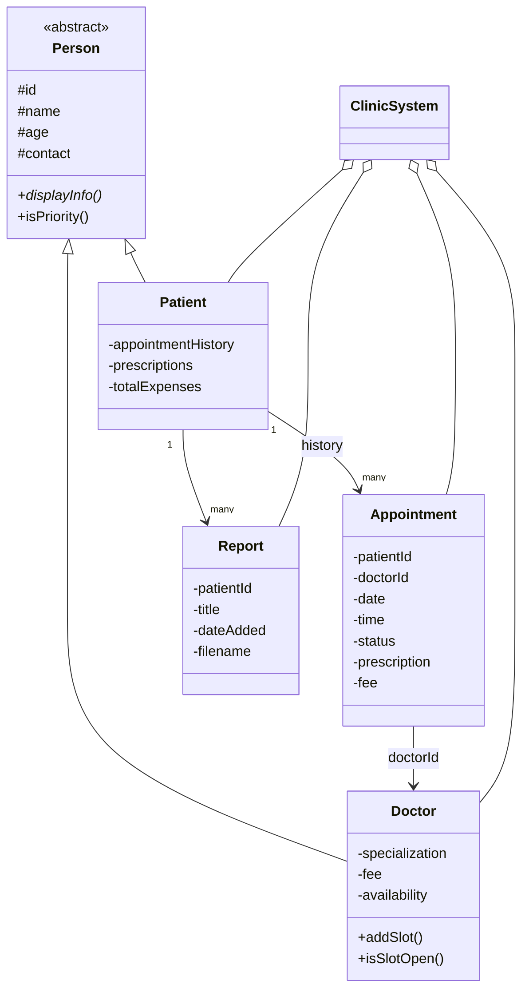

- `Person` is abstract with a pure virtual `displayInfo()`; `Doctor` and `Patient` override it.
- `ClinicSystem` owns all records, applies booking and billing rules, and loads and saves the data.
- Priority patients (under 10 or over 60) get a 20% discount and go to the front of the waiting queue.

```bash
g++ -std=c++17 -O2 -o clinic oop-CP.cpp && ./clinic   # in the backend repo root
```

</details>


## 🛣️ Honest limits and what's next

- **Sample‑data screens** (analytics, prescriptions, history, nurse queues, vitals, tasks) need their backend endpoints.
- **Record keys** come from the passphrase with a single SHA‑256 pass; production would use a proper KDF and a key manager.
- **Sessions and reset codes live in memory**, so a server restart signs everyone out.
- **Directory doctors** come from a public dataset and have no logins; their open times are generated.
- **Guidance is general information from a dataset, not a diagnosis.** In an emergency, call your local emergency number.

<div align="center">

<br>


**Beacon** · built with C++17, React and a lot of care

<sub>Photos in the app from <a href="https://unsplash.com">Unsplash</a> · Doctor listings from the Zocdoc dataset · Precautions from the Disease Precaution dataset · Tech icons by <a href="https://skillicons.dev">skillicons.dev</a></sub>


</div>
