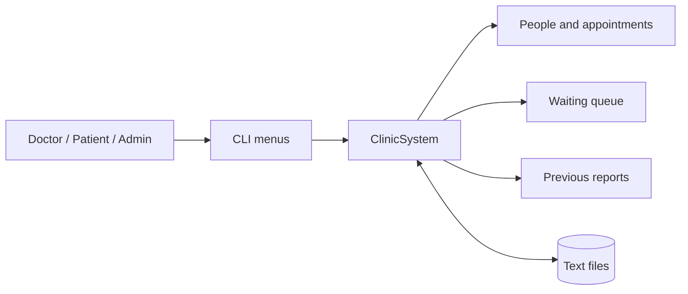
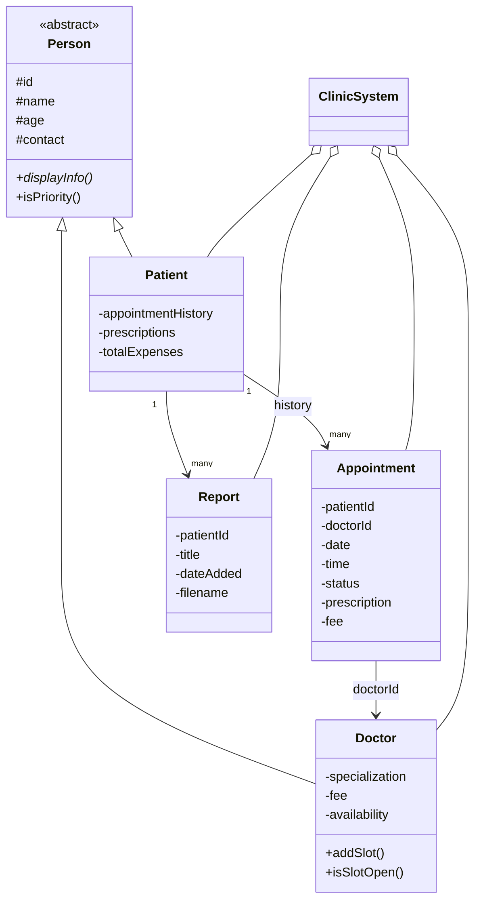
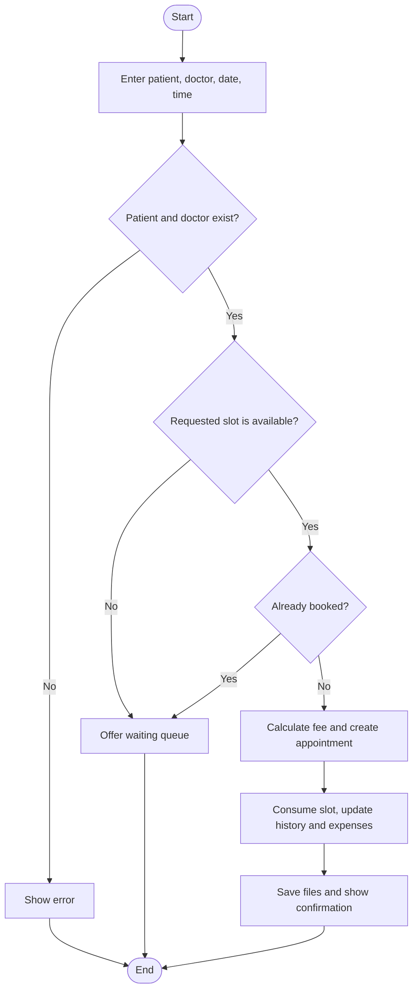

title: PatientCare
sdk: static
app_file: index.html
emoji: 🏥
colorFrom: blue
colorTo: green
pinned: false


# Clinic Appointment Management System

  

A menu-driven C++17 clinic system demonstrating object-oriented programming. Patients can book appointments, doctors manage schedules and prescriptions, and clinic data is saved in local text files.

## How It Fits Together



`ClinicSystem` coordinates the application. It owns the records, applies booking and billing rules, and loads or saves data. The menus provide the user interface; the model classes represent clinic entities.

## OOP Design



| OOP Concept | Where it appears |
|---|---|
| 🔹 **Abstraction** | `Person` defines shared identity and the pure virtual `displayInfo()`. |
| 🔹 **Inheritance** | `Doctor` and `Patient` derive from `Person`. |
| 🔹 **Polymorphism** | Each derived class overrides `displayInfo()`. |
| 🔹 **Encapsulation** | Model fields are private or protected and accessed through methods. |
| 🔹 **Composition** | `ClinicSystem` owns collections of doctors, patients, appointments, and reports. |

## Appointment Booking



**Priority Patients:** Younger than 10 or older than 60. They receive a 20% fee discount and are placed at the front of the waiting queue. Appointment statuses include pending, confirmed, rejected, and completed.

## Data and Features

- ✓ Doctors manage dated time slots; a booked slot is removed and a cancelled appointment reopens it.
- ✓ Patients can view appointment history, fees, prescriptions, and previous reports.
- ✓ Reports can be entered as text or imported from a file. Their content is stored under `reports/`; metadata is stored in `reports_index.txt`.
- ✓ Records are loaded at startup and saved after changes (and again when the application exits).
- ✓ The waiting queue exists in memory only and is cleared when the program exits.

| File | Stored Information |
|---|---|
| `doctors.txt` | Doctor profiles and availability slots |
| `patients.txt` | Patient profiles and total expenses |
| `appointments.txt` | Appointment details, status, and prescription |
| `reports_index.txt` | Report metadata and content-file path |
| `reports/` | Report content files |

> **Note:** Text fields use `|` as a record delimiter; avoid entering that character in stored values.

## Build and Run

Requires a C++17 compiler. From the project root:

```bash
g++ -std=c++17 -O2 -o clinic oop-CP.cpp
```

**Run on Windows:**

```powershell
.\clinic.exe
```

**Run on Linux or macOS:**

```bash
./clinic
```

The program creates the `reports/` directory as needed. Run it from the project root so its data files are read and written in the expected location.
>>>>>>> 763578a2664806e19a83273b7de856ad00a7ce31
